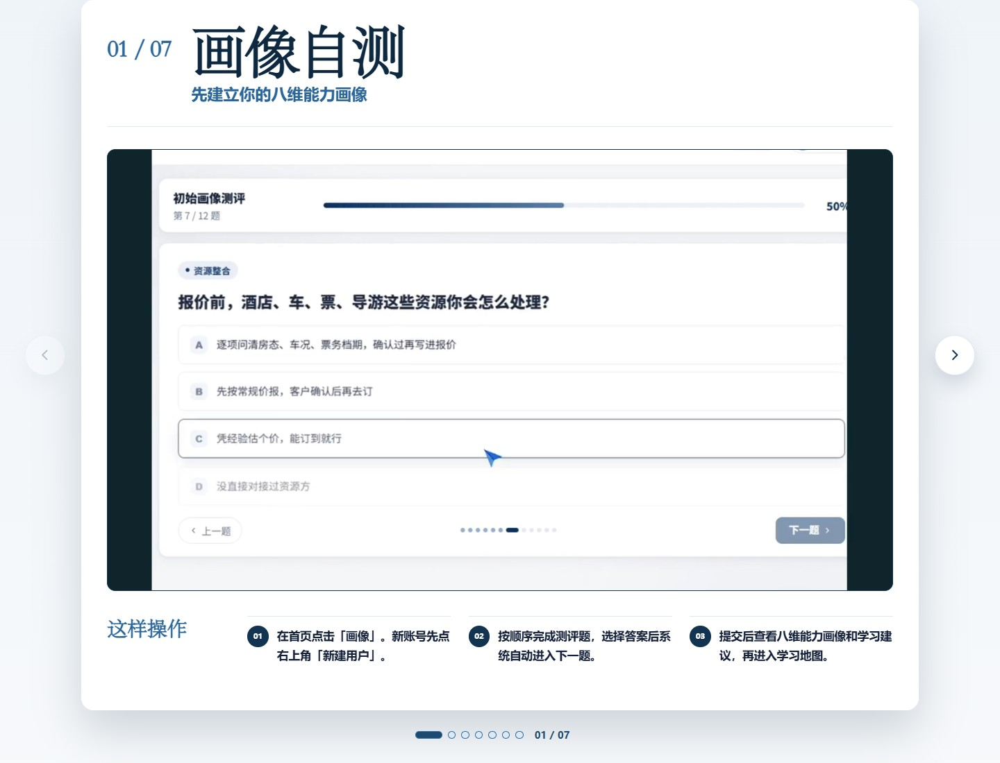

# 司南礼客

面向入境游定制师培训的个性化生成与多智能体协同决策系统。

项目采用 FastAPI 后端、Vue 3 + Vite 前端与 Electron 桌面壳，覆盖学情诊断、个性化学习、订单实战、交付物生成、证据核验、评分画像与经验沉淀等流程。


## 使用说明

在线使用说明：**[https://sinanlike.com/demo/index.html](https://sinanlike.com/demo/index.html)**

这是一个独立静态使用说明页，不依赖主应用登录，也不会出现在主项目导航中。页面采用横向轮播式使用说明卡，文字与录屏作为同一张卡片整体左右切换，逐步说明画像自测、个性化学习、动态做题、接单首呼、行前方案、行中应急与行后复盘的具体操作。

[](https://sinanlike.com/demo/index.html)

| 站点 | 演示环节 | 关键特色 |
| --- | --- | --- |
| 01 | 画像自测 | 八维能力基线、个人画像、学习建议，并以此驱动后续难度 |
| 02 | 个性化学习 | 学习地图、多 Agent 生成讲义/学习报告/实操指南，资源可回溯知识点与实战记录 |
| 03 | 动态做题 | 难度在一到五级之间实时调整，连续答对升档、失误降档，结果持续回写画像 |
| 04 | 接单与首呼 | 按画像派发订单、限时抢单、超时流单、首呼确认信息并结构化需求 |
| 05 | 行前方案 | 群聊询价、行程方案迭代、成本利润测算、分项报价、合同/保险/出团通知书 |
| 06 | 行中应急 | 随机突发事件入群，按“安抚客户 → 协调资源 → 解决问题”的顺序处置并参与评分 |
| 07 | 行后复盘 | 结算核对、赔偿追偿、实际利润、61 技能点逐项评分与证据坐标、画像回写下一单 |

页面源码位于 [`frontend/public/demo/`](frontend/public/demo/)，当前步骤的视频自动静音循环，支持左右箭头、进度圆点、触摸滑动和键盘方向键切换。

## 目录结构

- `tripcraft/`：后端服务、智能体、语音桥接、业务服务与数据存储
- `frontend/`：Vue 3 前端与 Electron 桌面应用
- `frontend/public/demo/`：独立产品演示页、网页版视频与封面素材
- `tests/`：后端测试
- `scripts/`：启动、验收、演示与维护脚本
- `data/`：领域知识与标准案例
- `docs/`：项目设计、状态与决策记录
- `_交接文档/`：安装、演示、配置与验收材料

面向新开发 Agent 的完整功能与交接说明见
[`docs/HANDOFF.md`](docs/HANDOFF.md)。

## 环境要求

- Python 3.11+
- Node.js 22.12+
- npm

## 快速开始

1. 参照 `_交接文档/配置示例/环境变量示例.txt` 创建本地 `local.env`。真实密钥不会提交到 Git。
2. 新机器首次运行：

   ```powershell
   powershell -NoProfile -ExecutionPolicy Bypass -File .\_交接文档\首次安装与适配.ps1
   ```

3. 普通训练模式：双击 `司南礼客桌面版.bat`。默认后端端口 `28020`，前端端口 `25190`。
4. 固定案例演示模式：默认后端端口 `28930`，前端端口 `25191`。

   ```powershell
   powershell -NoProfile -ExecutionPolicy Bypass -File .\启动标准演示.ps1
   ```

更完整的启动说明、演示流程与限制说明见 `00先读我.txt` 和 `_交接文档/`。

## 公网地址

- 正式入口：https://sinanlike.com
- 产品演示：https://sinanlike.com/demo/index.html
- 部署说明：`docs/CLOUDFLARE_DEPLOYMENT.md`

